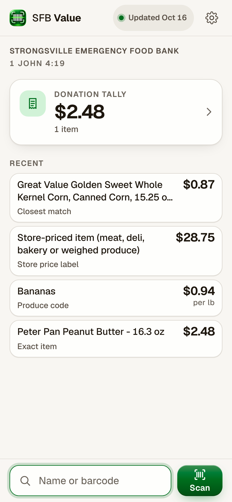
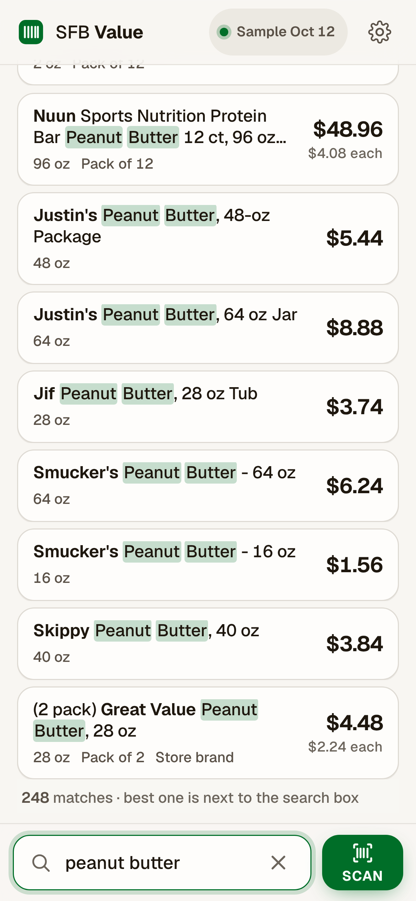
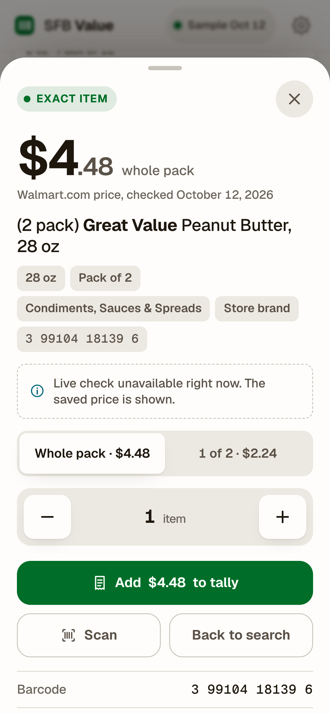
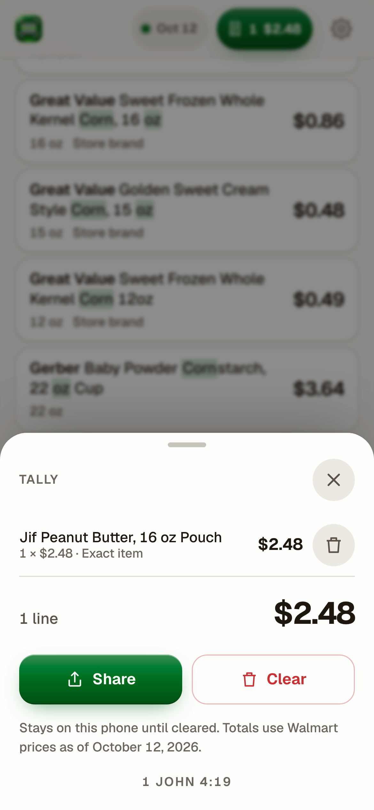

# SFB Value

**Scan or type a donated item and see its current Walmart price, with no signal and no subscription.**
Built for the volunteers of the Strongsville Emergency Food Bank (Strongsville, Ohio), who value every donation they
receive. Prices come from the Walmart I/O Affiliate API and, where the Strongsville Supercenter reports one, that store's
own shelf price.

<p>
  
  
  
  
</p>

## How volunteers use it

1. **Find the item.** Tap *Scan* and point the camera at the barcode, or type the name and size.
2. **Add it to the tally.** Check the item and its price, set the quantity, tap *Add to tally*.
3. **Review and share.** The tally keeps every line and the total; *Share* sends it on.
4. **Prices stay on the phone.** The app works without a signal; the price list updates itself when the phone is online.

The app never answers with a blank. A barcode finds the exact item (retired barcodes included, since donors give old
stock); a store-printed price label is decoded on the spot; a produce sticker gives the price per pound; a barcode Walmart
does not sell is valued at the closest Walmart equivalent and labelled as such; a typed search that has to drop a word says
which one. When the phone is online, an unknown barcode is also checked live. Every result says where its price comes from:
prices from the price list carry its date, a live price the time it was checked, a store label its own printed price.

It is a progressive web app: volunteers open it once, add it to the Home Screen (iPhone: Share › Add to Home Screen;
Android: the browser's Install button), and it then works offline on the phone already in their hand, iPhone (iOS 16.4 or
later) or Android (Chrome 111 or later). There is nothing to install from an app store and nothing to pay for; a Google
Play listing of the same app is possible (docs/RUNBOOK.md "Google Play").

## What is inside

| Part | Where | What it does |
|---|---|---|
| Crawler and quality gates | `crawler/`, `.github/workflows/pipeline.yml` | Crawls every in-scope Walmart department, normalises names, sizes and packs, builds a snapshot, holds it behind acceptance gates, publishes it. Runs on GitHub Actions; working data lives on the `data-store` branch. |
| Live price check | `pipeline/` | A Cloudflare Worker that signs Walmart requests for the app's online lookups, rate limited and cached. It also carries the schedule watchdog that keeps the pipeline running. |
| The app | `app/` | The offline PWA: a compact database pack per department, a search engine and barcode scanner that run on the phone, a tally. Deployed to Cloudflare by `.github/workflows/deploy-app.yml`. |
| Scope and rules | `data/` | Which departments are crawled, how items are categorised, the sentinel items every snapshot must contain, the acceptance thresholds, the refresh cadence, the search gold set. |
| Documentation | `docs/` | [RUNBOOK](docs/RUNBOOK.md) (operations), [DECISIONS](docs/DECISIONS.md) (every decision, dated), [WORKFLOW](docs/WORKFLOW.md) (how data flows), [SCHEMA](docs/SCHEMA.md), [CATEGORIES](docs/CATEGORIES.md), [HISTORY](docs/HISTORY.md), [READINESS](docs/READINESS.md), [PLAN](docs/PLAN.md). |

The snapshot in use holds about 2.4 million Walmart listings with 2.2 million barcodes across 15 departments: food,
health and medicine, pharmacy, personal care, beauty, baby, pets and household essentials, then party goods, seasonal,
home, toys, office supplies and emergency supplies. Clothing, footwear, alcohol, tobacco, media, vehicle parts and
wholesale lots are left out (see [CATEGORIES](docs/CATEGORIES.md)).

## How prices stay accurate without anyone watching

The pipeline runs itself. Every half hour a scheduled run (backed by a Cloudflare cron watchdog, because GitHub's
scheduler is unreliable) checks what is due and does one job: crawl, build, audit, identify or store prices.

- **Acceptance gates** hold a snapshot that would make the app worse: every department finished, every sentinel item
  priced, a live check of sampled prices against Walmart, size parsing, per-unit outliers, item and category counts
  against the previous snapshot, price drift, and a sample review of newly added rows judged on evidence. A held snapshot
  opens a GitHub issue; the previous snapshot stays live. After a publish, the app's deploy checks a 351-query search gold
  set on the built pack (below 95% opens an issue, below 90% the deploy stops and the live site keeps the previous build).
- **A weekly live audit** samples the published prices against Walmart and measures each department's price drift.
  Every department is re-crawled 30 days after its last crawl (`refresh.fixed_days`, 2026-10-19); the measured
  per-department planner (`crawler/cadence.py`) stays in the code, bypassed while that is set.
- **Store prices** for consumables come from the Strongsville Supercenter itself and are refreshed on their own cycle.
- **Alerts** are GitHub issues labelled `pipeline-alert`, one per condition, closed automatically when it clears. The
  [RUNBOOK](docs/RUNBOOK.md) lists every one and what it needs.

What the pipeline cannot decide for itself (crawl scope, thresholds, keys, money) is proposed as a pull request or an
issue; everything else ships without waiting. `CLAUDE.md` is the operating brief for that automation.

## Running it locally

```
pip install -r requirements.txt
python -m unittest discover tests          # crawler, gates, cadence, review, orchestration

cd app && npm install
npm test                                   # barcode maths, tokenizer, resolution, the Worker's routes
npm run fixture && npm run build && npm run serve   # the app on a synthetic 760k-item snapshot at http://127.0.0.1:8787/
```

The crawler also runs locally with `WM_CONSUMER_ID` and `WM_PRIVATE_KEY` set and `SFB_STORE` pointing at a checkout of the
`data-store` branch: `python -m crawler.ci --plan status`. Nothing in this repository holds a secret; keys live in GitHub
Actions secrets, Cloudflare Worker secrets and the owner's password manager.

## Status

The first real snapshot is published and the app serves it. Remaining before volunteers install it: the food bank's own
address for the app, a test on real phones from that address, and the two one-time operator steps listed in
[READINESS](docs/READINESS.md).

## License

[MIT](LICENSE). Use it for your own food bank; see "Another food bank" in [docs/READINESS.md](docs/READINESS.md) for
what to change. Bundled third-party components keep their own licences (zxing-wasm MIT, wrapping zxing-cpp Apache-2.0; Geist OFL); the Open
Food Facts data is ODbL.

## Acknowledgements

Prices from the [Walmart I/O Affiliate API](https://walmart.io/). Barcodes Walmart does not sell are identified through
[USDA FoodData Central](https://fdc.nal.usda.gov/) Branded Foods (U.S. Department of Agriculture, Agricultural Research
Service; public domain), [Open Food Facts](https://world.openfoodfacts.org/), [Open Beauty Facts](https://world.openbeautyfacts.org/) and
[Open Products Facts](https://world.openproductsfacts.org/) (ODbL). The scanner uses
[zxing-wasm](https://github.com/Sec-ant/zxing-wasm) (MIT), a WebAssembly build of [zxing-cpp](https://github.com/zxing-cpp/zxing-cpp) (Apache-2.0), where the browser has no barcode detector of its own; the
typeface is [Geist](https://vercel.com/font) (OFL). Built for and with the Strongsville Emergency Food Bank.
